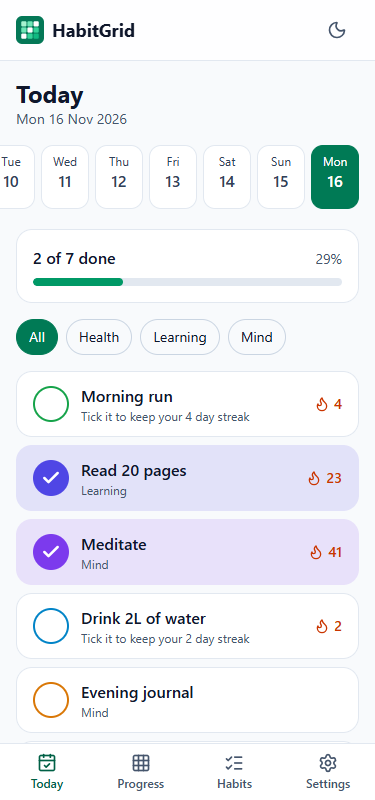
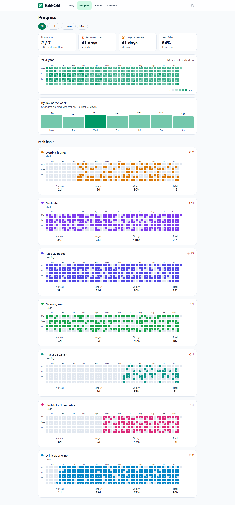
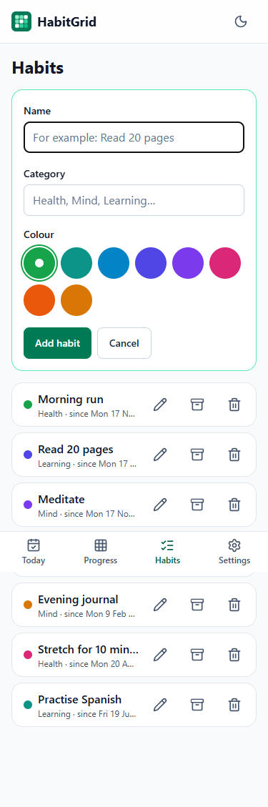
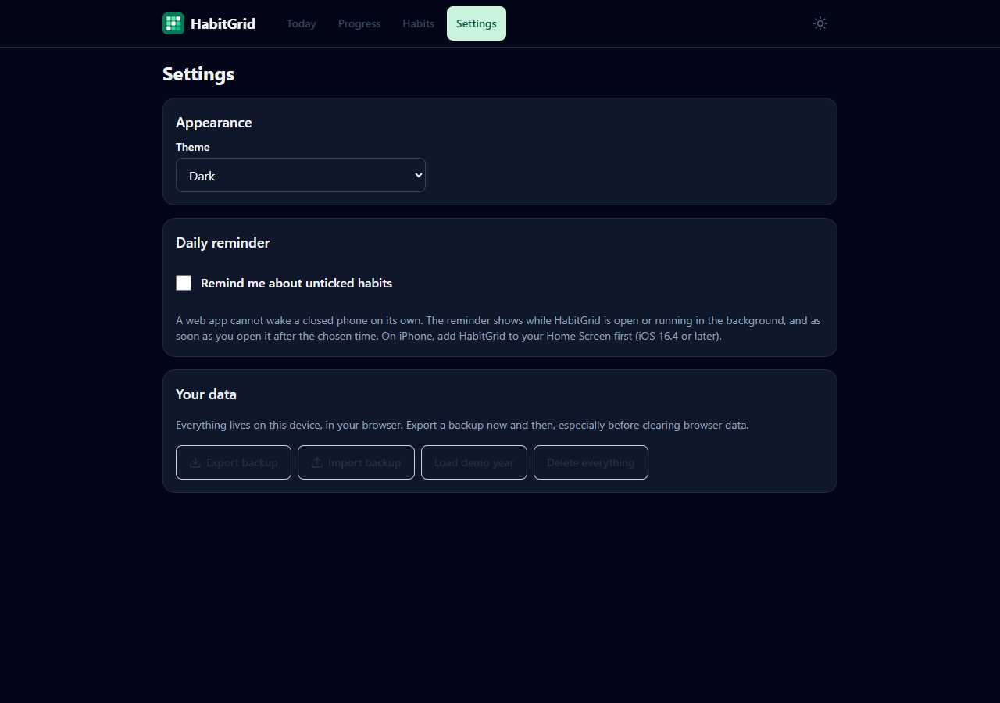

# HabitGrid

A minimalist habit tracker: tick habits off each day, watch a GitHub-style heatmap of your whole year fill in, and keep your streaks alive. Installable, works offline, and everything stays on your device.

**Live demo:** coming soon (built and tested locally; not deployed yet)
**Run locally:** see [Run locally](#run-locally)



## What to demo to a recruiter

1. **Today screen:** open the app (it starts with a year of demo data), tap a habit to tick it and watch its streak grow, then tap an earlier day in the date strip to fill in a missed check-in.
2. **Progress screen:** the 365-day heatmap for everything and for each habit, streaks, 30-day rates and a weekday breakdown, filterable by category.
3. **Works like an app:** install it, switch the phone to airplane mode and it still loads and saves. Set a daily reminder, export a backup and import it back.

## Features

- **Habits:** add, rename, recolour, archive (history is kept) and delete, with categories and eight colours.
- **Daily check-in:** one big tap target per habit, a two-week date strip for backfilling, a progress bar and a category filter.
- **Heatmaps:** a 53-week SVG grid for all habits together (five shades, darkest when everything is done) and one per habit in its own colour. Every square has a text description for hover and screen readers.
- **Streak engine:** current and longest streaks. A streak stays alive until a whole day passes without a check-in, so ticking at 11 pm still counts and the app tells you when a streak is at risk.
- **Stats:** done today, best current streak, longest ever, 30-day completion rate, perfect days, and consistency by weekday.
- **Reminder:** a daily notification for unticked habits (see the limits below).
- **Backup:** export and import as JSON. A file is validated completely before anything changes, and importing always asks first.
- **PWA:** installable, offline-first, with an update banner that waits for you to tap Reload. Light, dark or follow-the-device themes.

**Phase 2 (not built):** weekly-target habits (for example 3 times a week), optional Neon sync across devices, and a push server for reminders that fire while the app is closed.

## Stack

React 19, Vite, TypeScript (strict), Tailwind CSS v4, IndexedDB through `idb`, `vite-plugin-pwa` (prompt mode), Vitest with `fake-indexeddb`. No backend, no accounts and no secrets.

## Architecture notes

- **Dates are local calendar days (`YYYY-MM-DD`), never timestamps.** All day arithmetic uses UTC midnight of the same year, month and day, so a daylight saving change cannot make a day 23 or 25 hours long and skip or repeat a date. This is covered by tests that cross both the US and European clock changes, month and year ends, and a leap day.
- **Pure logic is separate and tested:** `lib/date`, `streaks`, `heatmap`, `stats`, `backup`, `reminder` and `demo` have no React or browser dependencies.
- **State lives in memory and is written through to IndexedDB.** The screen never waits on the database; each change is written afterwards, and if a write fails a banner says so. If the browser blocks storage entirely, the app runs from memory and says that changes will not be kept.
- **"Today" moves at midnight** (a timer plus a check when the app returns to the foreground), so the date and streaks are right after midnight without a reload.
- **Ticking a day before a habit's start date moves the start back**, so history stays consistent.
- **Small first load:** the daily screen is in the main bundle; Progress, Habits and Settings load on demand. There is no router (the screen is kept in the URL hash), and `idb` is used instead of a heavier database library.
- Deleting a habit removes its check-ins in the same IndexedDB transaction. Import and "load demo" replace everything in one transaction, so it is all or nothing.

```
src/lib/        date, streaks, heatmap, stats, backup, reminder, demo data, IndexedDB layer (all with tests)
src/providers/  HabitProvider (state + persistence), theme
src/features/   today, progress, habits, settings
src/components/ Heatmap, header, tab bar, update banner
```

## Performance

Measured on the production build:

| Condition | Result |
| --- | --- |
| Initial JavaScript | 81 kB gzipped (budget: under 100 kB) |
| Lighthouse, mobile profile with simulated slow 4G | Performance 97, Accessibility 100, Best Practices 100, SEO 100; LCP 1.9 s, total blocking time 160 ms, layout shift 0 |
| Unthrottled on localhost, first visit | first paint 204 ms, largest paint 388 ms |
| Unthrottled on localhost, repeat visit (service worker) | first paint about 70 to 90 ms, largest paint about 150 to 170 ms |

The sub-500 ms figures are local and unthrottled; on a real mobile connection expect roughly the Lighthouse numbers on the first visit, then near-instant loads from the cache.

## Notifications: what to expect

Reminders use the browser Notification API with the service worker. A web app cannot wake a closed phone by itself without a push server, so the reminder shows while HabitGrid is open or running in the background, and as soon as you open it after the chosen time (it only shows if habits are still unticked, and at most once a day). Browsers can also stop background pages to save battery. On iPhone, add the app to the Home Screen first (iOS 16.4 or later). Notifications must be allowed in the browser or phone settings; if they are blocked the settings screen says so.

## Run locally

Requires Node 22 or later.

```bash
npm install
npm run dev          # http://localhost:5305
```

To try the installable, offline build: `npm run build && npm run preview` (http://localhost:4175).
Other scripts: `npm run lint`, `npm run typecheck`, `npm test`.

## Screenshots

| Progress | Habits (phone) | Settings (dark) |
| --- | --- | --- |
|  |  |  |

## Verified

Typecheck, lint and build pass, and 74 automated tests pass (dates across daylight saving and leap years, streaks, heatmap layout, stats, backup validation, reminder timing, the demo data and the IndexedDB layer). A 72-check browser run (Playwright, Chromium) against the production build covered ticking and unticking with persistence across reload, backfilling a past day, category filters, the heatmaps and stats, habit add, edit, archive, restore and delete, theme, the reminder (a real notification, firing once for a past time and not repeating), export, import and its rejection of broken files, delete-everything and reload, offline reload and offline ticking, the midnight rollover with a faked clock, and 375px layouts with no overflow and no console errors. Not yet checked: a real phone (install, airplane mode and notifications), and deployment on Netlify.
